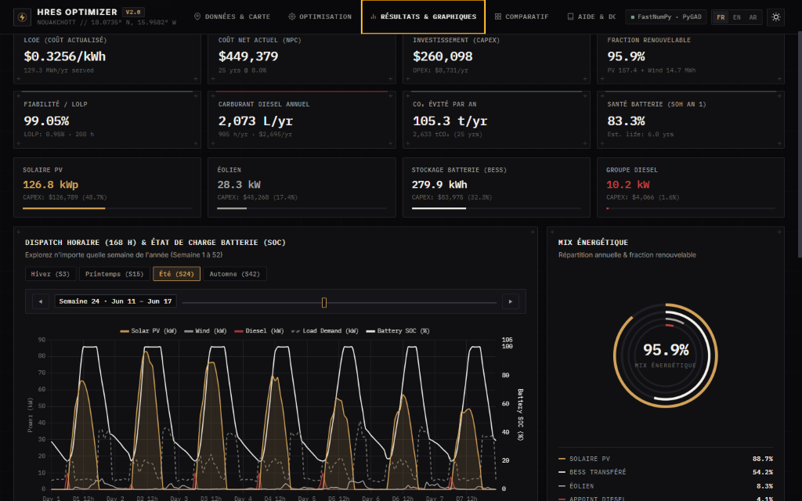
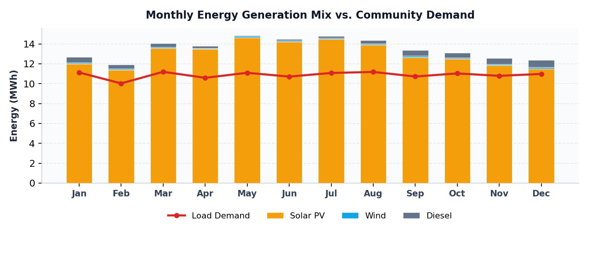
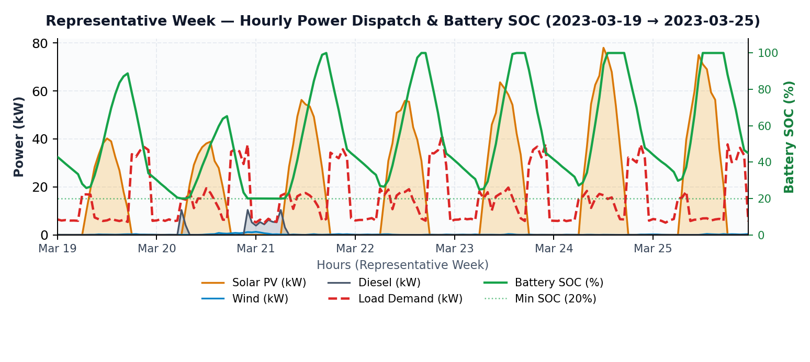
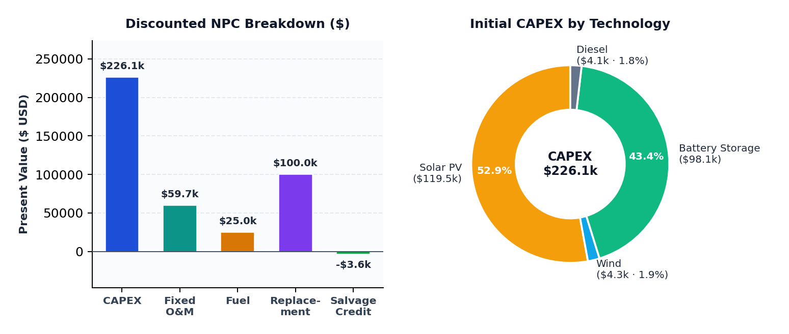

# HRES Optimizer — Rural Microgrid Techno-Economic Sizing Suite


-1d4ed8)


**HRES Optimizer** is an offline-capable Python **Web & Desktop engineering suite** (FastAPI + Leaflet + Chart.js + CustomTkinter + FastNumPy) built to design, simulate, and economically optimize **Hybrid Renewable Energy Systems (HRES)** for off-grid rural communities across West Africa and the Sahel.

It combines an accelerated **8,760-hour chronological physical modeling engine** (~23 ms per full-year run — **~7.8× faster** than object-loop evaluation) with a **Genetic Algorithm (GA) optimizer** to find the lowest **Levelized Cost of Energy (LCOE)** and **Net Present Cost (NPC)** under strict power reliability (**LOLP**) constraints — and exports **1-click print-ready A4 engineering & financial reports (HTML/PDF)**.



---

## Key Capabilities

- **Modern Web Application & Mobile PWA (`python web_app.py`) — Zero Node.js Required**: Precision architectural Single-Page Web App served by FastAPI with **Dark & Light themes**, live **FR / EN / AR (RTL)** language switching, real-time GA convergence charts & progress bars, interactive **Week 1–52** 168-hour dispatch & battery SOC slider, concentric radial Energy Mix telemetry, mobile responsiveness (`375px+`) + PWA installability, and 100% graceful offline fallback.
- **Interactive Map Picker & NASA POWER API**: Interactive **Leaflet** map powered by free **Esri ArcGIS** basemaps (Dark Gray Canvas, World Street Map, and World Imagery Satellite — zero API key or OSM 403 errors) with quick-jump benchmark cities (Nouakchott, Dakar, Benguerir, Abu Dhabi, Marseille) and NASA POWER hourly weather retrieval + local JSON cache + deterministic offline physical fallback.
- **One-Command Cloud / Free Hosting Ready (`Dockerfile`)**: Deployable out-of-the-box on **Hugging Face Spaces (Docker, port 7860)** or **Render** using lightweight `requirements-web.txt` (headless Linux, no desktop GUI dependencies).
- **Community Load Profile Generator & Custom Uploads**: Synthesizes realistic diurnal demand curves combining residential households (morning/evening peaks), schools (weekday daytime load), and health clinics (continuous 24/7 cold-chain load), or ingests custom 8,760-row CSV/Excel weather & load files (with automatic `W/m² → kW/m²` and leap-year normalization).
- **8,760-Hour FastNumPy EMS & Battery Aging Engine**: Simulates hourly load-following dispatch across PV, Wind, BESS, and Diesel backup while enforcing C-rate limits, SOC bounds (20%–100%), diesel 30% minimum load constraints, and cyclic battery **State of Health (SOH)** capacity fade.
- **Genetic Algorithm Sizing Engine**: Jointly optimizes PV (`kWp`), Wind (`kW`), Battery (`kWh`), and Diesel (`kW`) capacities to minimize LCOE under a user-defined LOLP threshold using `pygad` with an automatic pure-NumPy GA fallback and pre-computed unit renewable arrays.
- **1-Click Bankable Engineering & Financial Report Exporter (`HTML / PDF`)**: Generates a 100% self-contained, print-ready A4 engineering report (zero external CDN dependencies) with embedded high-DPI Matplotlib charts, CAPEX/OPEX/Replacement/Salvage cash-flow tables, CO₂ avoided estimates (IPCC factor), and full methodology notes — directly printable to PDF via browser `Ctrl+P`.
- **Multi-Scenario Comparator & Legacy Desktop App**: Compare architectures side-by-side (`100% Diesel Baseline` vs. `Solar+BESS` vs. `Hybrid`) with CSV export, and optionally run the classic CustomTkinter desktop app (`python main.py`).

---

## Featured Case Study — Nouakchott Peri-Urban Village, Mauritania

Generated directly from the built-in simulation, GA optimization, and reporting pipeline (`18.0735° N, -15.9582° W` | 60 households + medium school + 24/7 health clinic | Target `LOLP ≤ 1.0%` | 25-year lifetime @ 8% discount rate | Diesel `$1.30/L`):

| Metric | Optimal Result |
| :--- | :--- |
| **Solar PV Capacity** | `125.80 kWp` |
| **Wind Turbine Capacity** | `2.79 kW` |
| **Battery Storage (BESS)** | `338.28 kWh` (Year-1 SOH: `84.67%`) |
| **Backup Diesel Genset** | `10.37 kW` (`1,798.2 L/yr` fuel) |
| **Levelized Cost of Energy (LCOE)** | **`$0.2949 / kWh`** |
| **Net Present Cost (NPC)** | **`$407,077`** (Initial CAPEX: `$226,082`) |
| **Renewable Energy Fraction** | **`96.37%`** |
| **System Reliability / LOLP** | **`99.07%`** (`LOLP = 0.927%`) |

> **Full Interactive Sample Report**: Open [`examples/sample_report_nouakchott.html`](examples/sample_report_nouakchott.html) in any browser and press `Ctrl+P` to export a clean A4 PDF.  
> **Reproduce from CLI**: `python examples/generate_nouakchott_case_study.py`

### 1. Monthly Energy Generation Mix vs. Community Demand


### 2. Representative Week — Hourly Dispatch & Battery State of Charge (SOC)


### 3. Lifecycle Cost Breakdown (NPC) & Initial CAPEX Allocation


---

## Software Architecture

```text
CAPAPP/
├── data_handlers/
│   ├── weather_api.py        # NASA POWER hourly API client, JSON cache & offline physical fallback
│   └── load_generator.py     # 8,760h community demand generator (households, school, clinic)
├── models/
│   ├── pv_system.py          # NOCT cell temperature & thermal derating PV model
│   ├── wind_system.py        # Power-law hub-height wind shear & piecewise cubic power curve
│   ├── battery_system.py     # SOC dynamics, C-rate limits, self-discharge & cyclic SOH fade
│   └── diesel_system.py      # Linear Willans fuel curve (F0, F1) & 30% wet-stacking constraint
├── simulation/
│   ├── ems.py                # Chronological hourly Energy Management System (load-following)
│   └── engine.py             # 8,760-hour simulation engine & annual KPI aggregator
├── optimization/
│   ├── financials.py         # Discounted cash-flow NPC, CRF, replacements, salvage & LCOE
│   └── ga_optimizer.py       # PyGAD + pure-NumPy fallback Genetic Algorithm optimizer
├── reporting/
│   └── report_generator.py   # 1-click self-contained A4 HTML/PDF report & high-DPI chart exporter
├── web_app.py                # FastAPI REST backend & static SPA server (http://127.0.0.1:8000)
├── Lancer_Web_HRES.bat       # 1-click Windows launcher for the Modern Web Application
├── web/
│   ├── index.html            # Responsive 5-tab single-page engineering web interface
│   ├── styles.css            # Executive Dark/Light SaaS design system with RTL support
│   └── app.js                # Leaflet map, Chart.js suite, live GA polling & comparator
├── gui/
│   ├── app.py                # Legacy CustomTkinter desktop interface (CartoDB tiles)
│   ├── components.py         # Reusable sliders, entries & themed Matplotlib canvases
│   ├── translations.py       # Complete FR / EN / AR (RTL) localization dictionary
│   └── tutorial.py           # Interactive first-launch walkthrough guide
├── examples/
│   ├── generate_nouakchott_case_study.py
│   ├── sample_report_nouakchott.html
│   └── *.png                 # Showcase engineering charts
└── tests/
    ├── test_hres.py          # Physics, 8,760h energy balance, financials & GA unit tests
    ├── test_reporting.py     # Report generator & regression tests
    └── test_web_api.py       # FastAPI REST API end-to-end tests
```

---

## Installation & Usage

### Prerequisites
- Python 3.10+ (No Node.js required!)

### 1. Install Dependencies
```bash
pip install -r requirements.txt
```

### 2. Launch the Modern Web Application (Recommended)
```bash
python web_app.py
```
Then open **`http://127.0.0.1:8000`** in any modern browser (or double-click `Lancer_Web_HRES.bat` on Windows to launch and open automatically).

### 3. Launch the Legacy Desktop Application
```bash
python main.py
```
After running an optimization (or using the default startup simulation), open the **Results** tab and click **"Export Report (HTML/PDF)"** to generate a standalone engineering report ready for `Ctrl+P → Save as PDF`.

### 4. Run the Nouakchott Case Study via CLI
```bash
python examples/generate_nouakchott_case_study.py
```

### 5. Run the Unit Test Suite
```bash
python -m unittest discover -s tests -v
```

### 6. Build Standalone Windows Executable
```bash
python build.py
```
Generates `dist/HRES_Optimizer/HRES_Optimizer.exe`.

---

## Core Physics & Financial Equations

- **Solar PV**: $T_{\text{cell}} = T_{\text{amb}} + \frac{G}{0.8}(\text{NOCT} - 20)$, $\; P_{\text{PV}} = P_{\text{rated}} \cdot f_{\text{derating}} \cdot G \cdot \left[1 + \alpha_P (T_{\text{cell}} - 25)\right]$
- **Wind Turbine**: $V_{\text{hub}} = V_{\text{anem}} \left(\frac{H_{\text{hub}}}{H_{\text{anem}}}\right)^{\alpha}$ with piecewise cubic power curve between $V_{\text{cut-in}}$ and $V_{\text{rated}}$
- **Battery Storage (BESS)**: Hourly energy balance with charge/discharge efficiency, C-rate caps, self-discharge, and cumulative throughput SOH capacity fade
- **Diesel Generator**: $\text{Fuel}(t) = F_0 \cdot P_{\text{rated}} + F_1 \cdot P_{\text{gen}}(t)$ with $P_{\text{gen}} \ge 0.30\,P_{\text{rated}}$ minimum loading rule
- **Financials**: $\text{NPC} = \text{CAPEX} + \text{OPEX}_{\text{disc}} + \text{Repl}_{\text{disc}} - \text{Salvage}_{\text{disc}}$, $\; \text{LCOE} = \frac{\text{NPC} \cdot \text{CRF}(d, N)}{E_{\text{served}}}$
